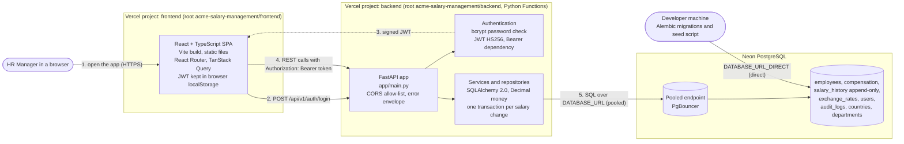

# Architecture

This document describes the system as implemented. Deeper detail lives in the application docs: [database design](../acme-salary-management/docs/database-design.md) and [implementation status](../acme-salary-management/docs/implementation-plan.md). The diagram source is also available as [architecture.mmd](architecture.mmd).

## 1. System overview

One GitHub monorepo (`acme-salary-management/`) is deployed as **two separate Vercel projects** with different root directories, plus a **Neon** database. The browser talks only to the frontend (static files) and to the backend API; only the backend talks to the database.

## 2. Responsibilities

| Part | Responsibility | Key files |
|---|---|---|
| **Frontend** (React 18, TypeScript, Vite, Tailwind v4) | Screens, client-side validation, previews of increments (`decimal.js`), server-state caching (TanStack Query), keeping directory filters in the URL, attaching the JWT to requests | `src/pages`, `src/features`, `src/services/api.ts`, `src/hooks/auth.tsx` |
| **Backend** (FastAPI, SQLAlchemy 2.0, Pydantic v2) | HTTP routes only in `api/routes`; business rules and transactions in `services`; query construction in `repositories`; schema in `models`; settings, errors and security in `core` | `backend/app/` |
| **Database** (PostgreSQL on Neon) | Source of truth; integrity (constraints, unique keys, append-only trigger); all search, filter, sort and aggregate work | `backend/alembic/versions/0001_initial_schema.py` |
| **Deployment** (Vercel + Neon) | Frontend as a static Vite build; backend as one FastAPI function; managed Postgres. Migrations and seeding run from a developer machine, never in a request | `frontend/vercel.json`, `backend/vercel.json`, `backend/.python-version` |

Backend entrypoint: `backend/app/main.py` exposes `app`, which Vercel detects automatically. `GET /health` is liveness; `GET /health?deep=true` also runs `SELECT 1`.

## 3. API surface (24 operations, from the app's OpenAPI schema)

| Group | Operations (all under `/api/v1`, all require a Bearer token unless marked public) |
|---|---|
| Auth | `POST /auth/login` (public), `GET /auth/me` |
| Employees | `GET, POST /employees`; `GET, PATCH /employees/{id}`; `GET /employees/{id}/salary-history` |
| Compensation | `GET, POST /compensation`; `GET, PATCH /compensation/{id}`; `POST /compensation/{id}/increment`; `POST /compensation/{id}/increment/preview` |
| Analytics | `GET /analytics/{dashboard, departments, countries, distribution, trends, currencies}?currency=` |
| Exchange rates | `GET, POST /exchange-rates`; `GET /exchange-rates/convert` |
| Lookups | `GET /lookups` |
| Health (outside `/api/v1`, public) | `GET /health` |

Errors use one envelope: `{"error": {"code", "message", "details": [{"field", "message"}]}}`, which the frontend maps onto form fields.

## 4. Main request and data flows

**Directory listing.** The filters, sort, page and page size live in the URL. TanStack Query calls `GET /employees?...`. The route validates the query; the repository builds one `SELECT` (employees outer-joined to compensation, country and department eager-loaded) with the filters, `ORDER BY` including an `id` tie-break, `LIMIT/OFFSET`, plus a separate `COUNT`. Salary filters and sorting use an SQL expression that annualises pay and converts it into the selected reporting currency.

**Applying a salary increment.** The UI previews the result with `decimal.js` and asks for confirmation, then calls `POST /compensation/{id}/increment`. The service opens a transaction, locks the compensation row (`SELECT ... FOR UPDATE`), validates (employee not terminated, effective date not earlier than the current one, result not negative), computes the new amount in `Decimal`, updates `compensation`, inserts a `salary_history` row and an `audit_logs` row, and commits once. Any failure rolls all three back.

**Analytics in a reporting currency.** The request carries `currency=INR|USD|EUR`. The service reads the latest rate per pair on or before today in one query, resolves each currency to the target (direct, inverse, or via USD), and PostgreSQL computes counts, averages, `percentile_cont` medians, minimums, maximums and sums. The response includes the rates used and their effective date, which the UI displays. Stored salaries are never changed.

## 5. Authentication and authorization (as implemented)

1. **Login.** The login page sends `POST /auth/login` with email and password. The backend looks up the lower-cased email, verifies the password with bcrypt (against a dummy hash when the email is unknown, so unknown email and wrong password behave the same), requires `is_active`, and returns a signed JWT (HS256, claims `sub` = user id and `exp`; default lifetime 480 minutes, `JWT_EXPIRE_MINUTES`) together with the user.
2. **Storing the token.** The SPA keeps the token in `localStorage` (`acme.token`) and adds `Authorization: Bearer <token>` to every request. On page load it calls `GET /auth/me`; if that fails the token is discarded.
3. **Checking the token.** Protected routes depend on `get_current_user`: it decodes and verifies the token with `JWT_SECRET`, loads the user by id and requires `is_active`; otherwise the response is `401`. The public endpoints are `POST /auth/login`, `GET /health` and the service-info `GET /`.
4. **Expiry and sign-out.** A `401` from any API call triggers the frontend's unauthorized handler, which clears the token and the query cache; the route guard sends the user to `/login`. Signing out does the same.
5. **Authorization.** There are no roles or permissions in the code. Any authenticated, active user may call every protected endpoint (the product has one persona, the HR Manager).
6. **Cross-origin.** CORS allows only the origins listed in `CORS_ORIGINS`, the methods `GET, POST, PATCH, DELETE, OPTIONS`, and the headers `Authorization` and `Content-Type`. Credentials/cookies are not used.

Trade-offs of this design (token in `localStorage`, no login rate limiting) are recorded in [design-decisions.md](design-decisions.md).

## 6. Deployment configuration (from the repository)

| | Frontend project | Backend project |
|---|---|---|
| Root directory | `acme-salary-management/frontend` | `acme-salary-management/backend` |
| Build | `npm run build` (`tsc -b && vite build`), output `dist` | none; Vercel installs `[project].dependencies` from `pyproject.toml` |
| Runtime | static files with an SPA rewrite to `/index.html` (`vercel.json`) | Python 3.12 (`.python-version`), entrypoint `app/main.py`, `maxDuration` 30 s (`vercel.json`) |
| Environment | `VITE_API_BASE_URL` (build-time; a production build without it refuses to call any API) | `DATABASE_URL` (Neon pooled), `JWT_SECRET`, `CORS_ORIGINS`, `APP_ENV=production` |

With `APP_ENV=production` SQLAlchemy uses `NullPool` (Neon's pooler does the pooling) and `/docs` is disabled. Hosts containing `-pooler` automatically get server-side prepared statements turned off. `DATABASE_URL_DIRECT` is used only by Alembic and the seed script. Variable reference: README section 12.
